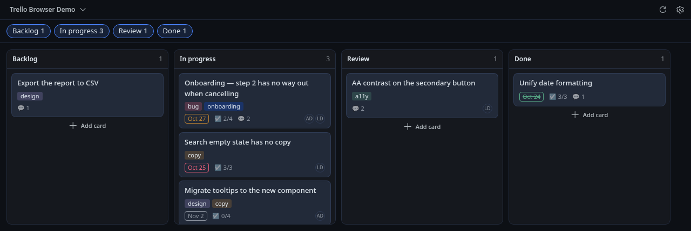
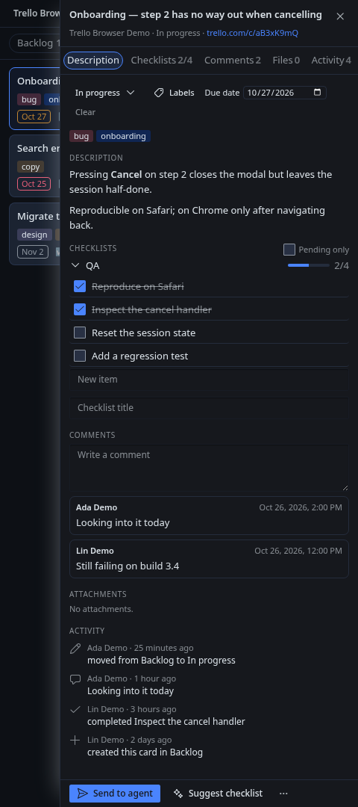
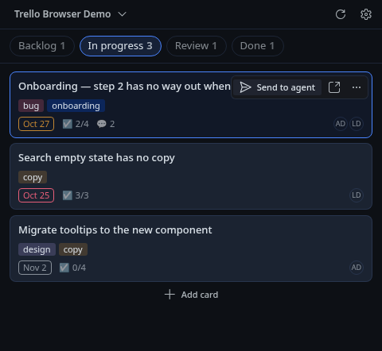
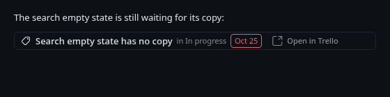

# Trello Browser for Hermes

Boards, lists and cards in a Hermes Desktop pane, next to the conversation — plus
one button that hands a card to the agent, which reads it, acts on it with tools,
and can drop a **live card chip** back into the chat.

| Board in columns | Card detail |
|---|---|
|  |  |

Status: early, but the core flows are implemented and covered by an offline test
suite (98 Python + 68 Node tests) plus a live smoke script. A pane is narrow by
nature, so below ~560 px it switches to a one-list-at-a-time layout:



## Why a pane instead of an embed

Trello's web app cannot be embedded: `trello.com` answers with
`Content-Security-Policy: frame-ancestors 'none'`, so an `<iframe>` or `<webview>`
inside an editor pane is refused by the browser. The honest alternative is to
reimplement the part you actually use against the Trello REST API and connect that
surface to the agent — which is what this plugin does.

## What it does

**The workspace**

- Board picker (starred first, remembered between sessions), lists with card
  counts, and the cards of the selected list.
- Card drawer: description (safe markdown subset), interactive checklists,
  comments (read and write), attachments, and the card's activity feed.
- Writes from the pane: move between lists, comment, create a card, add a
  checklist or an item, toggle/rename/delete items, set a due date, toggle labels,
  archive (with confirmation).
- Refreshes only while it is on screen, keeps the last good payload visible and
  labels it `stale` when a refresh fails.

**The agent handoff**

- **Send to agent** on any card, or `s` on the selected one. A click inserts a
  compact, fenced card context block into the composer; `Shift` sends it straight
  away (configurable in the pane's settings).
- The block is deliberately small and explicitly marked untrusted, so the model
  treats card text as data:

```
[Trello card] Onboarding — step 2 has no way out when cancelling
board: Product Launch · list: In progress · due: 2026-10-29 (in 3 days) · labels: bug, onboarding
url: https://trello.com/c/aB3dK9xZ · id: 65f1c0a9d3e2b7001a9c4e11
--- card data (untrusted, from Trello) ---
description: …
checklists: QA [2/4] …
comments (latest 3): …
--- end card data ---
Use your Trello tools to read or update this card.
```

- Ten agent tools back it up, so a profile with the plugin enabled can read and
  write without any other Trello integration installed:

| Tool | What it does |
|---|---|
| `trello_boards` | Your boards |
| `trello_board_view` | Lists + cards of a board |
| `trello_card` | One card: description, checklists, comments, activity |
| `trello_search` | Search cards and boards |
| `trello_card_create` | Create a card in a list |
| `trello_card_update` | Rename, re-describe, move, set due, archive |
| `trello_card_comment` | Comment, prefixed with a configurable `🤖 ` marker |
| `trello_checklist_add` | Add a checklist |
| `trello_checklist_item_add` | Add an item |
| `trello_checklist_item_set` | Toggle or rename an item |

- The plugin ships a skill (`plugin:trello-browser`) that teaches the model the
  tool map, the untrusted-data rule and how to write back.

**Live cards in the transcript**

The agent can emit a directive on its own line and the conversation renders a live
chip — name, list, due, open in Trello:

`::trello{card="aB3dK9xZ"}`



## Install

```bash
hermes plugins install rauldev-yoru/hermes-trello-browser --enable
```

The package ships both halves: the Python plugin (tools + backend) and
`desktop/plugin.js`, which the desktop app copies into its own plugins directory.
Both are **off by default** — turn them on in **Capabilities → Plugins**, then open
the pane from the command palette (**Open Trello**).

If the desktop app talks to a Hermes backend on another machine, the package's
automatic copy cannot reach the app's filesystem: install the desktop half
separately from the same repository when the install dialog offers it.

## Connect your Trello account

The pane asks for an API **key** and **token**, both from your own account:

1. Create a Power-Up at <https://trello.com/apps/admin> (any name works; only the
   credentials matter).
2. Open it → **Trello Auth** → **Generate a new API Key**. That is the API key.
3. Click the **Token** link next to that key, **Allow**, and copy the token.

Both are required and must come from the same Power-Up — a token presented with a
different app's key is rejected by Trello. The pair can also be provided through
`TRELLO_API_KEY` / `TRELLO_TOKEN` in the environment instead of the form.

## Privacy and what leaves your machine

Short version: credentials never reach the UI, traffic goes to `api.trello.com`
only, and card text is handed to the model as untrusted data. The full picture —
credential resolution order, the endpoint allowlist, what each tool returns, the
write scope and how to report a vulnerability — is in [SECURITY.md](SECURITY.md).

## Development

```bash
python3 -m unittest discover -s tests     # backend + agent half, no network
node --test tests/desktop/                # pane logic and rendered states (jsdom)
hermes plugins validate .
hermes plugins doctor . --ci
```

The desktop tests need `react`, `react-dom`, `jsdom` and `nanostores` resolvable
from the repo (or `$TRELLO_TEST_NODE_MODULES`); without them they skip instead of
pretending to pass.

Live helpers, both reading `TRELLO_API_KEY` / `TRELLO_TOKEN` from the environment:

```bash
python3 scripts/seed_demo_board.py --create-board "Trello Browser Demo"
python3 scripts/smoke_live.py --board <board_id>    # creates, comments, moves, archives
```

Design notes and the request/response contracts live in
[`docs/ARCHITECTURE.md`](docs/ARCHITECTURE.md). Screenshots are rendered from the
plugin's own render harness with the app's compiled stylesheet; see
[`docs/screenshots/README.md`](docs/screenshots/README.md).

## Scope

Deliberately not included (yet): drag & drop between lists, file uploads,
Power-Ups, custom fields, board creation, Trello webhooks (they need a publicly
reachable endpoint, which a self-hosted agent usually does not have — the pane
polls instead), a web-dashboard tab, and an offline write queue.

## License

MIT.
